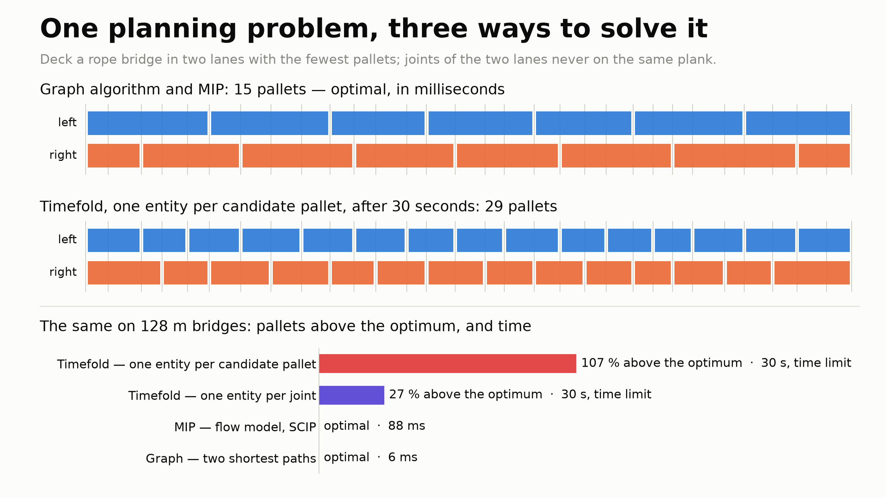

# Rope Bridge with Fixed Planks — Timefold vs Graph vs MIP

A rope bridge has its planks already in place. Its deck is laid in two lanes
from rigid pallets that run from plank to plank, and the joints of the two
lanes must not lie on the same plank. Which pallets give a valid deck with the
fewest pieces?

The problem is a set-cover-like selection from a list of candidate pallets,
and it is solved here in three ways:

- with **Timefold**, a constraint solver based on local search, in two models;
- with **graph algorithms**: lane after lane with shortest paths, and both
  lanes at once as two paths without a common interior node (a minimum-cost
  flow, found by two shortest-path computations);
- as a **MIP**, in an exact cover model and in a flow model whose linear
  relaxation is already integral, each solved with SCIP and with CP-SAT.

A hypothetical **extension** then changes the objective, to show how each
approach takes a new requirement: the pallets are cut from stock
pieces and the number of stock pieces is minimised. The MIP takes this as
three more constraints (model C); the graph algorithm cannot express it and
is left with cutting its finished plan afterwards, which costs about one
stock piece in thirteen on a 16 m bridge.



The point of the comparison: recognising the structure of a problem matters
more than the tool. The same solver that is stuck far from the optimum with
one model finds it quickly with another, and the graph and MIP formulations
solve in milliseconds what local search cannot prove at all.

- Problem: [docs/problem-statement.md](docs/problem-statement.md)
- Graph view and MIP models: [docs/mip-model.md](docs/mip-model.md)
- Timefold models: [docs/timefold-models.md](docs/timefold-models.md)
- Results: [docs/benchmark.md](docs/benchmark.md)

It is the fixed-plank variant of my
[rope bridge planning](https://github.com/tbulubas/rope-bridge-planning)
problem, where the plank positions are decisions too.

## Author

**Taras Bulubas** — taras.bulubas@gmail.com

All work on this project was done on my own hardware and in my private time.
All new and original ideas in it — the problem, the modelling approach and
its formulation — are my own and the result of many years of work in
optimisation, operations research and algorithms.

**Use of AI.** Claude (an AI assistant by Anthropic) was used to help write
the code and the documentation, following my specifications and decisions.

**License.** © 2026 Taras Bulubas. All rights reserved. This repository is
published for viewing only; any use requires my prior written permission —
see [License](#license). The one exception is the notebook, which you may run
and modify in Google Colab for personal, non-commercial exploration.

## Development environment

Requires Python 3.12 and GNU make 3.82+. SCIP and CP-SAT are shipped with OR-Tools. The
Timefold models additionally need JDK 25 (tested with Temurin 25) and Maven
3.9+; the Timefold Solver
itself is downloaded by Maven.

| Group       | Packages  | Used for        |
|-------------|-----------|-----------------|
| runtime     | `ortools` | the MIP models, SCIP and CP-SAT |
| extra `dev` | `pytest`  | tests           |
| extra `plot` | `matplotlib` | pictures of plans |
| extra `notebook` | `jupyterlab`, `pandas` (+ `plot`) | the notebook |

| Target               | What it does                                             |
|----------------------|----------------------------------------------------------|
| `make` / `make help` | list the targets                                         |
| `make venv`          | create `.venv` (Python 3.12) and install the project     |
| `make test`          | run the tests with pytest                                |
| `make run`           | solve an example instance; options with `ARGS="..."`     |
| `make image`         | render `images/rope-bridge-solver-comparison-linkedin.png` |
| `make notebook`      | open `notebooks/solver_comparison.ipynb` in JupyterLab   |
| `make notebook-check` | run all notebook cells headless and store the outputs   |
| `make timefold`      | build `timefold/target/fixed-planks-timefold.jar`        |
| `make benchmark`     | run all solvers and write `docs/benchmark.md`; options with `BENCH="..."` |
| `make clean`         | remove caches and build metadata                         |
| `make distclean`     | `clean` and remove `.venv`                               |
| `make recreate`      | `distclean`, then `venv` — a fresh environment           |

On Windows install make once with `winget install ezwinports.make`. For
IntelliJ IDEA see [docs/intellij.md](docs/intellij.md).

## Usage

```bash
make run
```

runs `python -m fixed_planks --length 16000 --seed 1` in `.venv`: it
generates a 16 m bridge with planks at random distances, solves it with the
graph algorithm, checks the plan with `verify` and prints both lanes.

Options: `-L/--length`, `--min-gap`, `--max-gap`, `-m/--min-pallet`,
`-M/--max-pallet`, `--seed`; `--solver` `graph` (default, both lanes at once), `graph-sequential`
(lane after lane), `scip-flow`, `scip-cover`, `cpsat-flow`, `cpsat-cover` (models B and A with
SCIP or CP-SAT), and for the extension `scip-stock`, `cpsat-stock` (model C)
or `graph-stock` (fewest pallets, cut afterwards); `--time-limit` seconds for the MIP solvers; `--save FILE` and
`--load FILE` write and read the instance as JSON.

The Timefold runner reads such a file:

```bash
java -jar timefold/target/fixed-planks-timefold.jar --instance out/bridge.json --model joints --seconds 10
```

with `--model` `pallets` or `joints`, `--target N` to stop at a valid plan
with N pallets, `--seed` and `--out FILE`.

## Notebook

[notebooks/solver_comparison.ipynb](notebooks/solver_comparison.ipynb) tells
the whole story: the problem and one solved bridge, the graph algorithms and
the MIP models live, the Timefold models, the benchmark charts, and the
extension with stock pieces.

**Online, nothing to install:** [](https://colab.research.google.com/github/tbulubas/rope-bridge-solver-comparison/blob/main/notebooks/solver_comparison.ipynb)

Its first code cell fetches this repository and installs the `fixed_planks`
package; then *Runtime → Run all* runs everything.

**Locally:** `make notebook`. The notebook is stored with its outputs, so it
can be read without running it; `make notebook-check` runs all cells headless
(about a minute) and stores the outputs again.

The notebook is Python and the Timefold models are Kotlin, so the notebook
shows the stored Timefold results from `docs/benchmark/`. Its one live
Timefold cell runs only where Java 25 or newer and the runner built by
`make timefold` are present, and is skipped otherwise — as in Colab.

## Image

```bash
make image
```

runs [scripts/linkedin_image.py](scripts/linkedin_image.py): it decks a 16 m
bridge with the graph algorithm and, for 30 seconds, with the Timefold model
that has one entity per candidate pallet, checks both plans with `verify`,
adds the results of the longest benchmark bridges from `docs/benchmark/` and
writes the image (2400 × 1350 px). It needs the Timefold runner.

## Tests

```bash
make test
```

The tests compare the two-lane graph algorithm and both MIP models with an exhaustive
search over all pairs of lanes on tiny random instances
([tests/exhaustive.py](tests/exhaustive.py)), including instances without a
valid plan, and with each other on bridges of the reference size; the lane-after-lane
algorithm must return a valid plan that is never better than the optimum.
Model C is compared with an exhaustive search over all plans and all ways of
cutting them.

## Layout

```
docs/                 problem statement, models, benchmark, IntelliJ setup
src/fixed_planks/
  instance.py         plank positions, candidate pallets, random instances, JSON
  solution.py         BridgePlan and the independent verify() and verify_cutting()
  graph.py            both lanes at once (minimum-cost flow) and lane after lane
  model.py            MIP models A (exact cover) and B (flow), SCIP or CP-SAT
  stock.py            extension: MIP model C with cutting from stock pieces
  draw.py             pictures of a plan and of its cutting
  cli.py              command line interface
notebooks/            solver_comparison.ipynb
timefold/             Kotlin module with the two Timefold models (Maven)
scripts/              benchmark.py, linkedin_image.py, check_venv.py
images/               the image
tests/                pytest suite; exhaustive.py searches tiny instances completely
.run/                 shared IntelliJ run configurations
Makefile              environment and task shortcuts
LICENSE               all rights reserved
```

## License

© 2026 Taras Bulubas. **All rights reserved.**

This repository — code, models, documentation, notebooks and images — is
published for viewing only. Using, running, copying, modifying or
distributing any part of it requires my prior written permission.

**Exception:** you may open, run and modify the notebook
`notebooks/solver_comparison.ipynb` in Google Colab for personal,
non-commercial exploration. Your modified copy is for yourself only; it may
not be published or redistributed, and the code and models may not be reused
elsewhere.

See [LICENSE](LICENSE) for the full terms. To ask for permission, write to
taras.bulubas@gmail.com.
